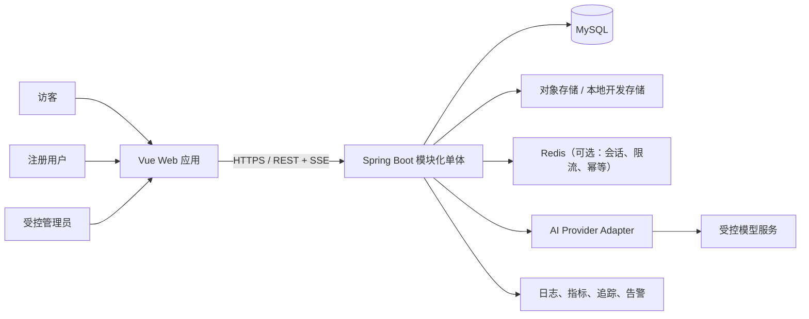
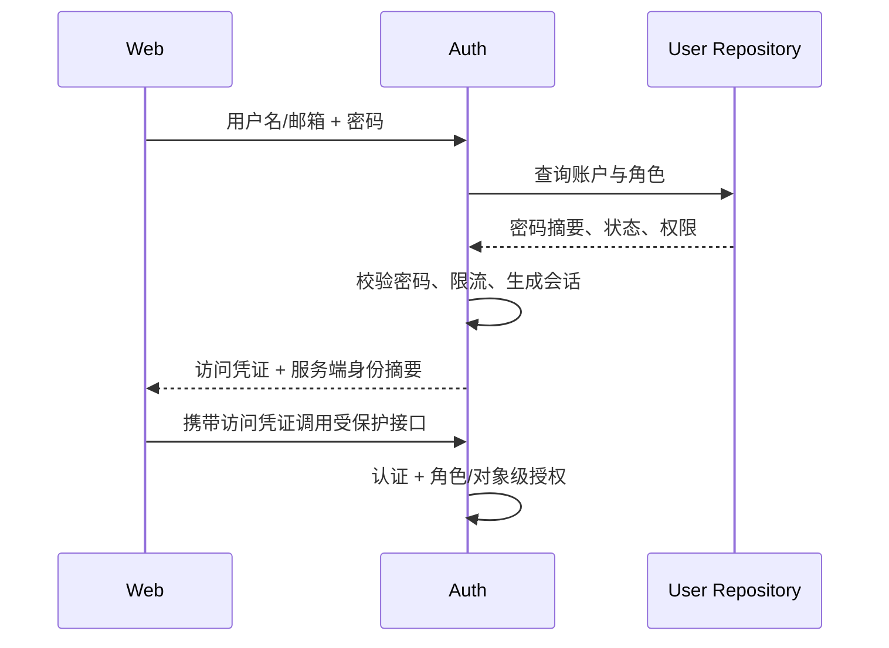
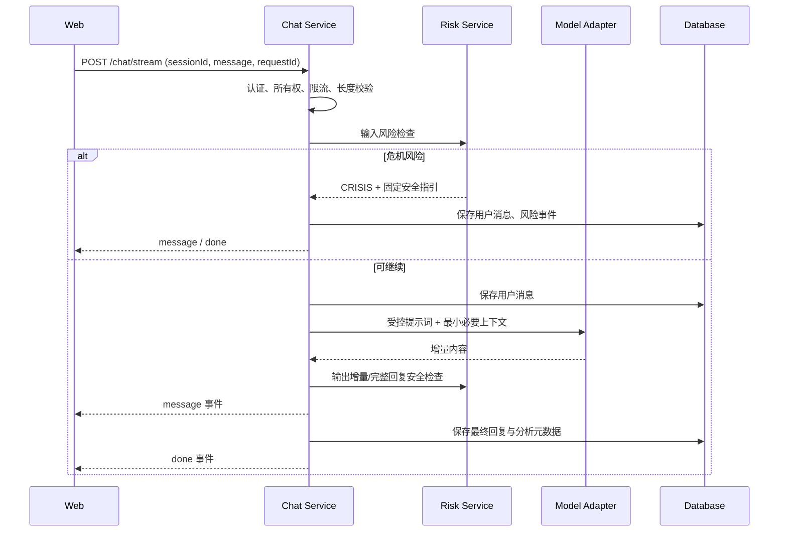
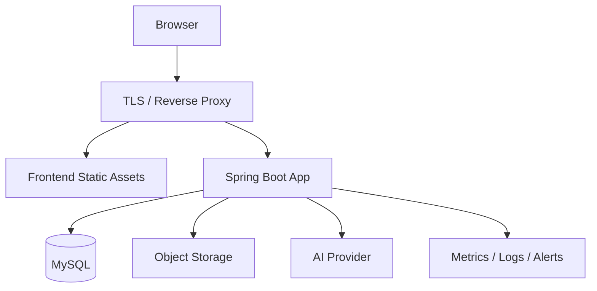

# MindHaven 架构分析与演进设计

> 版本：v0.1 · 2026-08-01  
> 原则：先描述仓库事实，再给出目标设计；“页面存在”不等于“能力已实现”。

## 1. 执行摘要

仓库目前更接近高保真前端原型：用户端和管理端已覆盖主要页面，API 调用层也勾勒出预期后端能力；后端只有可启动骨架，业务控制器、领域模型、认证授权、AI 集成和业务表均不存在。

建议首版采用“模块化单体 + 独立 AI 适配层”的形态。账户、日记、知识库、会话和运营仍在一个 Spring Boot 服务中，保持事务与部署简单；模型调用通过端口/适配器隔离，未来有明确的容量或合规压力时再拆分。当前阶段不需要微服务。

## 2. 当前仓库分析

### 2.1 目录与技术栈

```text
MindHaven/
├─ frontend/                  Vue 3 + Vite + Element Plus
│  └─ src/
│     ├─ api/                 Axios/SSE 接口封装
│     ├─ components/          登录、后台布局、编辑器等组件
│     ├─ route/               用户端/管理端路由与前端守卫
│     └─ views/               首页、聊天、日记、知识库、管理后台
├─ backend/                   Spring Boot 4 + Java 21 + JPA
│  ├─ database/init.sql       当前仅创建数据库
│  └─ src/main/               健康检查、CORS、统一响应
└─ docs/                      产品与研发基线
```

运行时依赖为 MySQL 8。前端开发服务器把 `/api` 和 `/files` 代理到 `http://localhost:1235`。

### 2.2 能力成熟度

| 能力 | 前端 | 后端/数据 | 当前结论 |
| --- | --- | --- | --- |
| 首页与导航 | 已有页面，未登录文章使用本地示例 | 无首页接口 | 原型可展示，营销数字无数据来源 |
| 注册登录 | 表单、验证码、路由守卫已存在 | 无认证接口/用户表 | 不可联调；角色由前端选择，存在严重越权风险 |
| 情绪日记 | 新建表单、管理列表/详情已存在 | 无日记接口/表 | 字段范围存在 1–5 与 `/10` 不一致 |
| AI 会话 | 会话列表、SSE、情绪花园已存在 | 无会话/消息/模型集成 | 前端为兼容未知后端保留大量多字段、多路径兜底 |
| 知识库 | 列表、详情、富文本、上传、管理 CRUD 已存在 | 无文章/分类/文件接口与表 | `v-html` 需要服务端清洗；上传链路未实现 |
| 数据看板 | ECharts 图表已存在 | 无聚合接口 | 当前从最多 500 条列表在浏览器估算，不可作为正式口径 |
| 运维基础 | Vite 构建配置 | 健康检查、Actuator、CORS、JPA、Flyway 与 MySQL 基线 | 缺少结构化日志、指标、容器化和 CI/CD |

### 2.3 当前关键技术债务

1. **授权模型不成立**：登录页允许选择 `userType=2`，且前端把该值覆盖进 `userInfo`；管理路由只依赖本地存储。必须由后端签发并校验角色。
2. **契约漂移**：分页参数同时出现 `current`、`currentPage`、`pageNum`，同一字段有 camelCase/snake_case 多种兜底，会掩盖联调错误。
3. **安全承诺超前**：首页声明“对话内容加密存储”，但后端没有任何存储或加密实现；上线前应实现或撤下文案。
4. **心理危机判断脆弱**：页面仅对两个中文标签展示警示，缺少固定风险枚举、输入/输出双重检查、落库、升级与审计流程。
5. **内容安全缺口**：文章详情直接使用 `v-html`，需要服务端 HTML 白名单清洗和安全响应头。
6. **令牌风险**：令牌放在 `localStorage` 且使用自定义 `token` 头；若发生 XSS 易被读取。应统一认证方案并降低令牌暴露面。
7. **前端承担数据计算**：看板拉取大列表后聚合，既不完整也浪费带宽，应改为后端统计接口。
8. **诊断代码残留**：生产路径记录接口结构、流式内容和响应；心理内容可能进入浏览器日志或采集系统。

## 3. 目标上下文架构



首版可不部署 Redis：单实例时使用数据库会话/限流，或使用短期签名访问令牌；但接口和代码应保留可替换的会话与限流抽象。

## 4. 后端模块化单体

推荐按业务模块组织，而不是全局 `controller/service/repository` 平铺：

```text
com.mindhaven/
├─ common/                    响应、异常、分页、时间、审计上下文
├─ auth/                      登录、令牌/会话、密码、当前主体
├─ user/                      用户资料、角色与权限
├─ diary/                     日记、个人趋势、日记分析
├─ chat/                      会话、消息、SSE、情绪分析
├─ knowledge/                 分类、文章、发布状态、阅读统计
├─ file/                      上传策略、元数据、对象存储适配
├─ risk/                      风险规则、风险事件与处置状态
├─ analytics/                 聚合查询与指标口径
├─ audit/                     管理员敏感操作审计
└─ infrastructure/            JPA、AI、存储、时钟、ID 等适配器
```

每个模块内部采用 `controller → application service → domain → repository`。Controller 只做协议转换和校验；业务规则进入应用/领域层；外部模型、文件系统和数据库通过接口隔离。

### 4.1 模块职责

| 模块 | 负责 | 不负责 |
| --- | --- | --- |
| auth/user | 身份认证、RBAC、账户状态、当前主体 | 依赖前端传入角色作决定 |
| diary | 日记所有权、校验、CRUD、个人趋势 | 直接拼接模型 SDK |
| chat | 会话/消息生命周期、SSE 编排、持久化 | 将供应商原始事件直接暴露给前端 |
| risk | 统一风险枚举、规则、事件、处置 | 进行临床诊断 |
| knowledge | 内容状态机、分类、清洗、阅读统计 | 信任客户端 HTML 与文件路径 |
| analytics | 固定口径的聚合查询 | 拉全量记录交给浏览器计算 |
| audit | 记录敏感管理操作 | 存储密码、令牌或完整敏感正文 |

## 5. 关键请求链路

### 5.1 登录与授权



前端路由守卫只改善体验，后端的角色与对象级授权才是安全边界。建议 Web 使用 `Authorization: Bearer`；若使用 Cookie，应采用 `HttpOnly + Secure + SameSite` 并配置 CSRF 防护。

### 5.2 AI 流式对话



服务端应把不同供应商事件转换为稳定的自有 SSE 协议。客户端不应继续猜测 `content/text/delta/reply/answer` 等字段。

### 5.3 文章发布

文章遵循 `DRAFT → PUBLISHED → OFFLINE → ARCHIVED`。只有 `PUBLISHED` 可被公共接口读取。正文在写入或发布前执行白名单清洗；封面先写临时对象，文章保存成功后绑定，失败时由清理任务回收孤儿文件。

## 6. 数据与一致性

- MySQL 是用户、日记、会话、文章、风险与审计数据的事实来源。
- 使用 Flyway 或 Liquibase 管理迁移，生产环境将 `ddl-auto` 设为 `validate`，禁止自动改表。
- 所有业务表包含 `created_at`、`updated_at`；需软删除的表增加 `deleted_at` 或 `deleted`。
- 对话发送使用客户端 `requestId` + 用户/会话唯一约束实现幂等，避免网络重试生成重复消息和重复模型费用。
- 风险分析、标题摘要等模型派生结果保留模型、提示词/规则版本和生成状态，便于回溯但不保存隐含推理过程。
- 聚合看板从数据库聚合或异步统计表读取，统计口径写入 API 和数据字典。

详见 [数据模型](./DATA_MODEL.md)。

## 7. 安全、隐私与心理安全

### 7.1 应用安全

- 密码使用 Argon2id 或 bcrypt 等适合密码的哈希；禁止明文、可逆加密和普通 SHA。
- 每个资源接口同时检查角色和所有权，尤其是日记、会话、消息、文件与风险事件。
- 富文本白名单清洗；上传校验 MIME、扩展名、文件头、大小和存储键；下载使用不可执行的响应头。
- CORS 使用明确域名；生产不允许通配来源；所有环境强制 TLS。
- 对登录、注册、模型对话、上传和导出实施限流与审计。

### 7.2 隐私

- 对话和日记属于高敏感数据。日志默认只记录 ID、耗时、状态和分类结果，不记录原文。
- 管理员默认只能看聚合或脱敏信息；访问原文需要额外权限、理由、审计和可追责界面。
- 首页“加密存储”等表述必须与实际数据库、备份和对象存储配置一致。
- 明确保留周期、用户导出/注销流程、模型供应商处理范围和跨境边界。

### 7.3 心理安全

- 风险判断使用稳定枚举，不以 UI 文案比较作为触发条件。
- 固定安全指引由本地策略生成，不能让模型自由改写或覆盖。
- 当模型服务不可用时，危机链路仍能返回基础求助信息。
- 对误报、漏报、文案地区适配和管理员处置时效建立测试与复盘机制。

## 8. 可观测性与错误处理

- 统一错误格式：`code`、`message`、`data`、`requestId`；HTTP 状态码表达协议结果，业务码表达稳定原因。
- 使用全局异常处理器，不向客户端返回堆栈、SQL 或供应商密钥。
- 关键指标：请求量/错误率/P95、登录失败率、SSE 首字时间与中断率、模型错误与成本、风险事件数量/处置时长、上传失败率。
- 结构化日志关联 `requestId`、用户匿名标识和会话 ID；敏感字段在采集前脱敏。
- 健康检查区分 liveness/readiness；readiness 检查数据库等必要依赖，模型服务可根据降级策略决定是否阻塞。

## 9. 部署拓扑与环境



至少设置 `local`、`test`、`staging`、`prod` 环境。配置通过环境变量或密钥管理注入；`.env.example` 只放键名和安全示例。前端构建产物不包含密钥。

## 10. 演进顺序

1. 固化 API 与数据模型，建立迁移和测试框架。
2. 实现认证、RBAC、对象级授权、审计和全局异常处理。
3. 实现日记、知识库与安全上传，先形成不依赖模型的闭环。
4. 接入 AI 会话、SSE、幂等、限流和风险分流。
5. 建立后端聚合看板、隐私控制、可观测性和上线演练。

详细里程碑见 [交付路线图](./ROADMAP.md)。

## 11. 架构决策记录（待建立）

建议在 `docs/adr/` 使用简短 ADR 记录以下决定：

- ADR-001：认证采用 Bearer 令牌还是安全 Cookie 会话。
- ADR-002：AI 模型供应商与数据处理边界。
- ADR-003：对象存储和私有文件访问方式。
- ADR-004：软删除、注销和数据保留策略。
- ADR-005：风险规则、地区化求助信息与人工处置责任。
