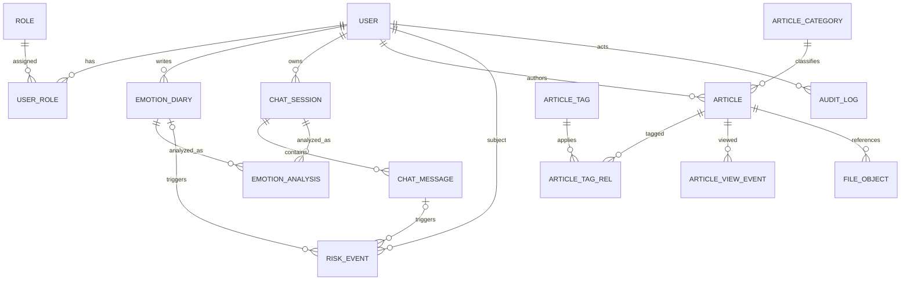
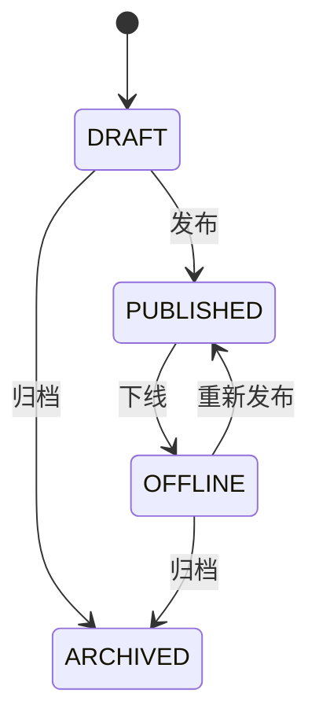
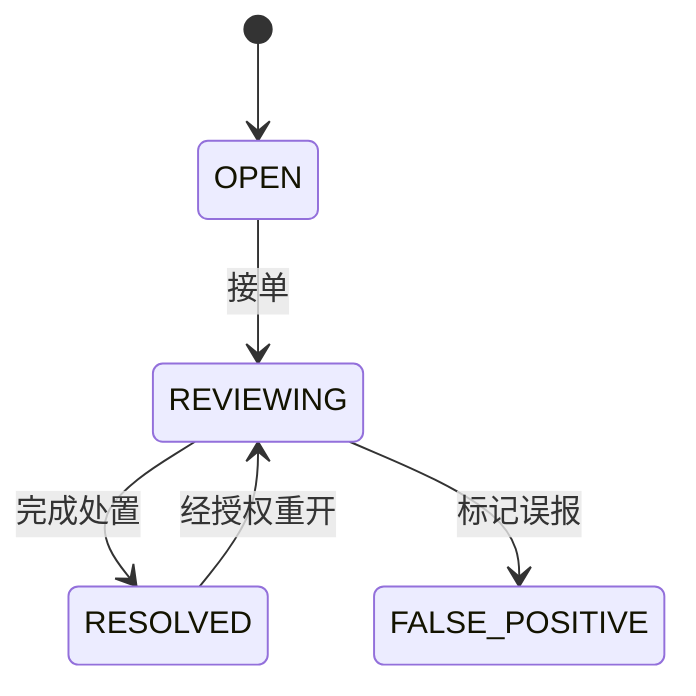

# MindHaven 数据模型设计

> 版本：v0.2 · 2026-08-03
> 状态：V1-V4 已落地并通过 Flyway/Hibernate 校验，后续变更仍需通过数据库设计评审。
> 实现位置：[`backend/src/main/resources/db/migration`](../backend/src/main/resources/db/migration)

## 1. 设计原则

- 业务主键建议使用 UUIDv7/ULID 或分布式长整型，并在 API 中以字符串返回。
- MySQL 使用 `utf8mb4`；时间使用带明确业务时区约定的 `datetime(3)` 或统一 UTC 存储。
- Schema 通过 Flyway/Liquibase 管理；生产 `spring.jpa.hibernate.ddl-auto=validate`。
- 日记、对话、消息、风险事件按高敏感数据分类，访问、备份、日志和导出遵循最小权限。
- 软删除不是永久保留。必须另行定义宽限期、物理清理和法定保留规则。

## 2. 实体关系

## 3. 核心表

### 3.1 用户与权限

#### `mh_user`

| 字段 | 类型建议 | 约束/说明 |
| --- | --- | --- |
| id | bigint/char(26) | PK |
| username | varchar(50) | 唯一、规范化后比较 |
| email | varchar(254) | 唯一、规范化后比较 |
| password_hash | varchar(255) | 仅保存密码哈希 |
| nickname | varchar(80) | 可空 |
| phone | varchar(32) | 可空，按隐私策略加密/脱敏 |
| avatar_file_id | 同主键 | 可空，FK `file_object` |
| status | varchar(20) | `ACTIVE/LOCKED/DISABLED/PENDING` |
| privacy_consent_version | varchar(30) | 注册时同意的版本 |
| consented_at | datetime(3) | 同意时间 |
| last_login_at | datetime(3) | 可空 |
| created_at/updated_at | datetime(3) | 非空 |
| deleted_at | datetime(3) | 可空 |

索引：规范化用户名/邮箱唯一索引；`status, created_at` 普通索引。禁止在业务表复制可信角色字段。

#### `mh_role` / `mh_permission` / 关联表

角色建议至少有 `USER`、`CONTENT_ADMIN`、`SAFETY_ADMIN`、`USER_ADMIN`。权限使用资源动作表达，例如 `article:publish`、`risk:read-sensitive`、`user:disable`。

#### `mh_auth_session`

保存服务端会话或刷新令牌摘要：`id`、`user_id`、`token_hash`、`expires_at`、`revoked_at`、`last_used_at`、设备摘要和创建时间。不得保存可直接使用的明文令牌。

### 3.2 情绪日记

#### `mh_emotion_diary`

| 字段 | 类型建议 | 约束/说明 |
| --- | --- | --- |
| id | 主键 | PK |
| user_id | 主键类型 | FK，非空 |
| diary_date | date | 非空；与 user_id 唯一（若一天一篇） |
| mood_score | tinyint | 1–10 |
| dominant_emotion | varchar(32) | 稳定枚举 |
| emotion_triggers | text | 敏感内容 |
| content | text | 敏感内容 |
| sleep_quality | tinyint | 1–5 |
| stress_level | tinyint | 1–5 |
| version | int | 乐观锁 |
| created_at/updated_at | datetime(3) | 非空 |
| deleted_at | datetime(3) | 可空 |

索引：`(user_id, diary_date desc)`、`(user_id, mood_score)`；后台风险查询不应直接依赖全表扫描正文。

#### `mh_emotion_analysis`

可关联日记或会话，使用 `source_type` + `source_id`：

- `emotion_score`：0–100。
- `label`、`is_negative`、`risk_level`、`risk_description`。
- `suggestion`、`improvement_suggestions_json`。
- `model_provider`、`model_version`、`policy_version`。
- `status`：`PENDING/SUCCEEDED/FAILED/SUPERSEDED`。
- `analyzed_at`、`created_at`。

约束：同一来源可保留多个版本，但只能有一个当前有效结果。不要保存模型的隐藏推理过程。

### 3.3 AI 会话

#### `mh_chat_session`

`id`、`user_id`、`title`、`status(ACTIVE/ARCHIVED/DELETED)`、`message_count`、`last_message_at`、`started_at`、`ended_at`、`created_at`、`updated_at`、`deleted_at`。

索引：`(user_id, last_message_at desc)`。`message_count` 是可重建冗余字段，更新需与消息写入保持一致。

#### `mh_chat_message`

| 字段 | 类型建议 | 说明 |
| --- | --- | --- |
| id | 主键 | PK |
| session_id | 主键类型 | FK，非空 |
| sender_type | varchar(16) | `USER/ASSISTANT/SYSTEM` |
| content | text | 敏感内容；不进入普通日志 |
| client_request_id | varchar(64) | 用户消息幂等键 |
| status | varchar(20) | `PENDING/STREAMING/COMPLETED/FAILED/BLOCKED` |
| finish_reason | varchar(30) | 可空 |
| model_version | varchar(100) | AI 消息可空/有值 |
| input_tokens/output_tokens | int | 成本统计，不暴露供应商机密 |
| created_at/completed_at | datetime(3) | 时间 |

唯一约束：`(session_id, client_request_id, sender_type)`；索引：`(session_id, created_at, id)`。

### 3.4 知识库

#### `mh_knowledge_category`

`id`、`parent_id`、`name`、`slug`、`sort_order`、`status`、`created_at`、`updated_at`。`slug` 唯一；需防止父子循环。

#### `mh_article`

`id`、`category_id`、`author_user_id`、`title`、`summary`、`content_html`、`cover_file_id`、`status`、`view_count`、`published_at`、`created_at`、`updated_at`、`deleted_at`、`version`。

索引：`(status, published_at desc)`、`(category_id, status, published_at desc)`；搜索成熟后再引入全文索引/搜索服务。

#### `mh_tag` / `mh_article_tag`

标签名称唯一；关联表以 `(article_id, tag_id)` 为联合唯一键。不要长期以逗号字符串作为事实模型。

#### `mh_article_view_event`（V4 已创建）

当前保存 `article_id`、`view_date` 与创建时间，用于按日统计阅读趋势。现实现每次详情请求都会新增事件并累加文章 `view_count`，尚未按用户/访客去重；正式指标需要明确去重窗口并决定是否增加匿名主体哈希。流量增大后可改为异步事件与日聚合表，避免保存完整 IP。

### 3.5 文件

#### `mh_file_object`

`id`、`storage_provider`、`storage_key`、`original_name`、`content_type`、`size_bytes`、`sha256`、`business_type`、`business_id`、`business_field`、`owner_user_id`、`status(TEMP/BOUND/QUARANTINED/DELETED)`、`created_at`、`deleted_at`。

存储键由服务端生成；URL 是派生数据，不应把长期公开 URL 当作唯一文件身份。

### 3.6 风险与审计

#### `mh_risk_event`

| 字段 | 说明 |
| --- | --- |
| id、user_id | 风险事件与主体 |
| source_type/source_id | `CHAT_MESSAGE` 或 `EMOTION_DIARY` |
| risk_level | `NORMAL/CONCERN/WARNING/CRISIS`，一般仅为非 NORMAL 落事件 |
| trigger_codes_json | 命中的规则代码，不保存隐藏推理 |
| redacted_summary | 默认展示的脱敏摘要 |
| policy_version/model_version | 可回溯版本 |
| status | `OPEN/REVIEWING/RESOLVED/FALSE_POSITIVE` |
| assigned_to/resolved_by | 处置人，可空 |
| resolution_note | 受控访问的处置说明 |
| detected_at/resolved_at | 时间 |

索引：`(status, risk_level, detected_at)`、`(user_id, detected_at desc)`。

#### `mh_audit_log`

记录管理员登录、角色修改、敏感内容查看、文章发布、风险处置、删除与导出。字段包括 `actor_user_id`、`action`、`resource_type/id`、`result`、`reason`、`request_id`、脱敏后的客户端信息和 `created_at`。审计日志禁止由普通业务账户修改。

## 4. 数据状态机

## 5. 数据生命周期（待决策）

| 数据 | 建议方向 | 待确认 |
| --- | --- | --- |
| 访问/应用日志 | 短周期、无正文、自动清理 | 具体天数与合规要求 |
| 日记/对话 | 用户可见、可删除；注销进入宽限后物理清理 | 保留期限、备份清理时限 |
| 风险事件 | 最小化保存，权限隔离 | 法定/业务保留期限 |
| 审计日志 | 防篡改、比普通日志更长 | 保留期限与访问主体 |
| 文件 | 临时文件自动回收；业务解绑后延迟清理 | 回收窗口和病毒扫描策略 |

## 6. 迁移计划

1. 已引入 Flyway：V1 基线、V2 参考数据、V3 中文情绪列、V4 文章阅读事件均已应用。
2. 用户/RBAC、日记、知识库、文件、会话、分析、风险与审计实体/仓储已落地。
3. 下一步用 Testcontainers 验证空库迁移、约束、索引和聚合查询，并补充跨版本升级测试。
4. 明确阅读去重、数据保留、软删除和物理清理策略，再通过新迁移交付所需字段/索引。
5. 随真实查询量评估聚合表或事件异步化，不提前拆分数据库。
